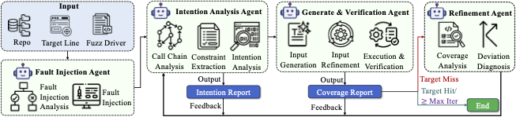

## AgenticDIG



- **Fault Injection Agent:** Targets error handling-related patches and automatically writes Mock components to trigger error handling code.
- **Intention Analysis Agent:** Analyzes project source code, extracts code context from the entry point to the patch location, and deeply analyzes and understands the intent of code constraints, especially for complex ones.
- **Generate & Veification Agent:** Generates directed test inputs for precise test patching in the form of Python Script.
- **Refinement Agent:** Analyzes coverage reports and identifies deviation points from the expected path.

### Quick Start

#### Install Opencode

```shell
curl -fsSL https://opencode.ai/install | bash
```

### Add Skills

```shell
# move .claude/skills/* to your opencode skill dir, e.g., ~/.config/opencode/skills/
cp -r ./.claude/skills/* ~/.config/opencode/skills/
```

### Run Code

```shell
python main.py --lang {lang} --project {project_name} --idx {data_idx} --dataset_path {json_path4dataset}

# E.g. (uses the bundled minimal dataset, data/test.json; the Java target is idx 2):
# python main.py --lang java --project jsoup --idx 2 --dataset_path ../data/test.json

# E.g. (uses the full 422-target benchmark, data/full_targets.json; ids are composite like "c_cpp-cpp-httplib-1"):
# python main.py --lang c_cpp --project cpp-httplib --idx 1 --dataset_path ../data/full_targets.json
```

The script matches a target by its composite id (`{lang}-{project}-{idx}`, e.g.
`java-jsoup-2` in `data/full_targets.json`) or by the plain index in the bundled
`data/test.json` (ids `1`, `2`, `3`). If no target matches, the script prints the
available targets and exits with a non-zero code instead of failing silently.

> Note: `--mode llm`-style seed generation and the agent itself require an LLM
> backend. `opencode` must be installed and configured with your own API key
> (e.g. `opencode run ...` with the `deepseek/deepseek-chat` model). The artifact
> does not bundle any API key; reviewers must supply their own.

